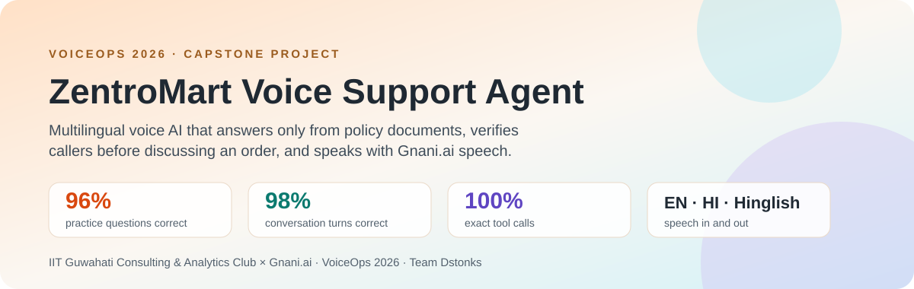
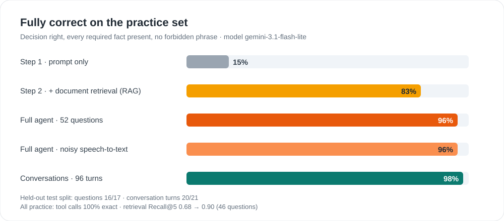

<div align="center">



# VoiceOps 2026: ZentroMart Voice Support Agent

**A multilingual voice AI customer-support agent.** It listens with Gnani speech-to-text, answers only from company policy documents (RAG) with a Google Gemini LLM, verifies the caller before discussing an order, and replies with Gnani text-to-speech, in English, Hindi and Hinglish.


[Quick start](#quick-start) · [How one call works](#how-one-call-works) · [Results](#results) · [Real example](#a-real-call-from-sample_outputs) · [Demo video](demo.mp4) · [Report](report1.pdf) · [FAQ](#faq)

Repository: [github.com/nightraven4545/voiceops-2026](https://github.com/nightraven4545/voiceops-2026)

</div>

## In short

- **What it is:** a phone-style support agent for **ZentroMart**, a fictional Indian online store selling groceries and electronics. Callers speak a question; the agent answers from the store's return, refund, delivery, cancellation and warranty policies; it looks up their order once they prove who they are; and it hands over to a human with a ticket when the policy says a person must decide.
- **Who built it:** Team Dstonks (Shreshtha), for the **VoiceOps 2026 capstone** of the LLM & Generative AI course by the **IIT Guwahati Consulting & Analytics Club × Gnani.ai**.
- **How well it works on the dataset's practice set:**
  - **96%** of 52 single questions fully correct, against **15%** for a prompt-only LLM
  - **98%** of 96 conversation turns fully correct
  - **100%** exact tool calls
- **The core idea:** the LLM only *understands* and *phrases*. Everything that must not go wrong is plain, unit-tested Python: identity checks, order lookups, dates, refund timelines, the pincode table and when to escalate.

## Highlights

| | |
|---|---|
| 🎙️ **Voice in, voice out, Gnani only** | Gnani STT in English (`en-IN`), plus a Hindi (`hi-IN`) second pass when the caller speaks Hindi, so spoken numbers come back as digits. Gnani TTS voices Kaveri (English), Bhavna (Hindi) and Poorvi (Hinglish). |
| 📚 **Grounded answers, cited** | Hybrid search (BM25 + multilingual embeddings) over 84 policy sections, ranked by authority (policy > guide > help > FAQ > marketing). Every answer lists the section IDs it used. |
| 🙅 **Says "I don't know" instead of guessing** | When the documents don't cover a question, the agent searches wider once, then says it doesn't have that information and offers a human colleague. |
| 🔐 **Verified order help, private data protected** | Order ID first, then the last 4 phone digits or the delivery pincode (`lookup_order`). One retry per order, then a polite refusal. Phone, pincode, email and customer ID are stripped from order-lookup results, so the stored customer record never reaches the LLM. |
| 🧮 **Policy maths in code** | Business days (Mon–Sat minus holidays), return windows, refund arrival dates, overdue checks, and delivery, COD and Express for a pincode or city from the pincode table. |
| 🤝 **Honest handovers** | Escalation follows the policy's own triggers. A ticket is mentioned only after `create_ticket` really returns `created=True`. Replies claiming a refund, cancellation or approval are caught and rewritten. |

## How one call works

```mermaid
flowchart LR
  A([Caller audio]) --> B[Gnani STT<br/>en-IN + hi-IN]
  B --> C[Understand<br/>LLM call 1]
  C --> D[Rules in code<br/>verify · tools · dates · escalation]
  D --> E[Find the policy<br/>BM25 + multilingual-e5]
  E --> F[Compose<br/>LLM call 2]
  F --> G[Safety checks<br/>no fake actions · no guessing]
  G --> H[Gnani TTS<br/>Kaveri · Bhavna · Poorvi]
  H --> I([Spoken reply + cited sources])
  classDef speech fill:#FFF1E6,stroke:#E8590C,color:#7A2E0E
  classDef llm fill:#EFEBFC,stroke:#5F45C2,color:#2E1F73
  classDef code fill:#E3F6F3,stroke:#0B7A6F,color:#0B3D37
  class A,B,H,I speech
  class C,F llm
  class D,E,G code
```



1. **Hear:** audio in any common format is converted to 16 kHz mono, cut into pieces of 30 s or less, and transcribed by Gnani. Silence gets "Sorry, I didn't catch that."
2. **Understand (LLM call 1):** the model turns the words and recent turns into a clean English search query, the caller's language, products, dates and flags. This is how a follow-up like "and if I paid by card?" works.
3. **Rules in code:** order IDs trigger `lookup_order` and the identity check. Dates, windows, refund timelines and pincode facts are computed, and the policy decides whether to refuse or escalate.
4. **Find the policy:** keyword search and meaning-based search are fused (reciprocal rank fusion); the top sections are shown to the model, labelled by authority.
5. **Compose (LLM call 2):** two or three short sentences in the caller's language, written only from that evidence. The model also returns the section IDs it relied on and whether they cover the question.
6. **Safety checks:**
   - no claimed actions or private digits, otherwise the reply is rewritten
   - required facts are checked (refund reference number, refused-at-door timing), with one rewrite if one is missing
   - "I don't know" when the evidence doesn't cover the question
7. **Speak:** dates are read as "27 October 2026" and order IDs in groups of four, then Gnani TTS speaks in a voice that matches the language.

## Results



| Practice set, `gemini-3.1-flash-lite` | Step 1: prompt only | Step 2: + retrieval | Full agent | Full agent, noisy `asr_text` |
|---|---|---|---|---|
| Fully correct (52 questions) | 15% | 83% | **96%** | **96%** |
| Required facts present | 23% | 87% | 98% | 98% |

- **Conversations (23 conversations, 96 turns):**
  - **98%** of turns fully correct
  - **100%** correct decisions
  - **100%** exactly the expected tool calls
  - evidence recall 0.94
- **Retrieval:** section-ID **Recall@5 is 0.90** over the 46 questions with section-level gold evidence, up from 0.68 when searching with the raw text. In Hindi it's 0.86, up from 0.43.
- **Held-out test split:** we tuned on a fixed development split; the held-out test split scores 16/17 questions and 20/21 conversation turns.
- **Voice end to end:** every file in `sample_outputs/` is processed, including silence, and one bad file never stops a batch.

Full method, failure analysis and what we would fix next are in the **[4-page report](report1.pdf)**.

## A real call from `sample_outputs`

Hinglish, verification, then handover. These are the agent's own outputs, unedited (`sample_outputs/replies/PC002/`).

| # | Caller (as heard by Gnani STT) | Agent | Tool call |
|---|---|---|---|
| 1 | hello mujhe order ke baare mein help chaahiye | Hello, main ZentroMart ka AI support assistant hoon. Aapke order ke baare mein madad karne ke liye, kya aap mujhe apna order ID bata sakte hain? | |
| 2 | order number hai 89782837 | Shukriya. Order details check karne ke liye, kripya ya toh apne registered mobile number ke last 4 digits batayein ya phir is order ka delivery pincode share karein. | `lookup_order(order_id=89782837)` |
| 3 | last four digits 4,533 hai | Shukriya verification ke liye. Aapke order 89782837 mein Zentro Vista TV damaged report kiya gaya hai, isliye main ek colleague ko connect kar raha hoon jo is priority matter mein aapki madad karenge. | `lookup_order(order_id=89782837, verification_value=4533)` |
| 4 | monezantro vista 43 inch four k smart tv damage report kiya tha abhi replacement approved car do naa | Main samajh sakta hoon ki aap replacement chahte hain. Maine aapke damaged TV ke liye support ticket raise kar diya hai aur hamari priority resolution team ke ek colleague jald hi aapse contact karenge. Woh is mamle mein aapki aage ki sahayata karenge. | `create_ticket()` |

The agent never "approves" the replacement. A damaged item worth more than ₹10,000 must go to a human (ESC-1), so it raises a ticket and says so only because the ticket was really created.

## Quick start

Python 3.12 (the pinned numpy needs it). **On Windows, clone into a short path** (e.g. `C:\voiceops`): torch's installed file paths are long, and without [long-path support](https://pip.pypa.io/warnings/enable-long-paths) `pip install` fails inside deep folders.

```bash
git clone https://github.com/nightraven4545/voiceops-2026.git voiceops   # Windows: clone into e.g. C:\voiceops
cd voiceops
python -m venv .venv
.venv/Scripts/activate            # Windows; on macOS/Linux: source .venv/bin/activate
python -m pip install -r requirements.txt   # `python -m pip` also works where Windows blocks the pip.exe launcher
cp .env.example .env              # then fill in the keys
```

`.env` needs:
- `GNANI_API_KEY`: from app.gnani.ai/voice → API Keys.
- `LLM_API_KEY`: a Gemini key (aistudio.google.com/apikey). The default model is `gemini-3.1-flash-lite`. Any OpenAI-compatible endpoint works via `LLM_BASE_URL` / `LLM_MODEL`; for Claude set `LLM_PROVIDER=anthropic`, `LLM_MODEL=<a Claude model>` and `ANTHROPIC_API_KEY`.
- `DATASET_DIR`: path to the extracted `Capstone_Project_Dataset_FTTT_2026` folder (default: inside this repo). The dataset is not committed.

The first run downloads the `intfloat/multilingual-e5-small` embedding model (~470 MB) from Hugging Face.

## Run on a folder of audio

```bash
python run.py --input path/to/audio --output outputs
```

- Audio files directly in the input folder are separate calls. Each **sub-folder is one conversation**: its files are played to the same agent in natural order (`turn1`, `turn2`, …).
- Any common format works (wav, mp3, m4a, ogg, flac, webm, …). Audio is converted to 16 kHz mono and split into pieces of 30 s or less for Gnani STT.
- For every input file the output folder gets:
  - `<name>.wav`: the spoken reply
  - `<name>.txt`: the reply text
  - `<name>.json`: transcripts, reply, decision, cited section IDs, the retrieved chunks with text and scores, tool calls and timings

  Plus one `results.csv` for the whole run. A failing file is recorded and the batch continues.

## Live demo

```bash
python app.py        # open http://127.0.0.1:7860, record or type a question
```

Shows the transcript and the spoken reply. For each turn it also shows the decision, cited sections, tool calls and verification state. A 2:10 recorded spoken demo is in [`demo.mp4`](demo.mp4). It was recorded on `gemini-3.5-flash-lite` while 3.1 was returning overload errors; all reported numbers use `gemini-3.1-flash-lite`.

## Evaluate

```bash
python -m pytest tests                              # date / window / escalation / ASR rules vs gold
python eval/evaluate.py --mode retrieval [--asr]    # section-ID Recall@k on the raw text, no LLM (prints to the console)
python eval/evaluate.py --mode retrieval --rewrite  # same with the agent's English rewrite (needs cached LLM rewrites: run --mode full first)
python eval/evaluate.py --mode baseline             # Step 1: prompt only
python eval/evaluate.py --mode rag                  # Step 2: + retrieval
python eval/evaluate.py --mode full [--asr]         # full agent on single questions
python eval/evaluate.py --mode conversations        # multi-turn, incl. exact tool calls
python eval/make_audio.py --out test_audio --questions PQ0003 --conversations PC002   # Gnani-TTS test audio
```

Results of the LLM modes are written to `eval/results/` as CSV and markdown tables. LLM responses are cached in `.cache/` so re-runs are free and repeatable. Add `--split dev` or `--split test` to score one fixed part.

The submission zip contains only the files the brief asks for. `app.py`, `eval/` and `tests/` are in the [GitHub repository](https://github.com/nightraven4545/voiceops-2026).

## Repository layout

| Path | What |
|---|---|
| `run.py` | Batch voice command |
| `app.py` | Gradio live demo |
| `src/agent.py` | Conversation state, verification, tools, LLM calls, guards |
| `src/kb.py` | Section parser and hybrid retrieval |
| `src/rules.py` | Business days, return windows, refund timelines, escalation flags, ASR normaliser |
| `src/voice.py` | Gnani STT/TTS, audio conversion |
| `eval/` | Practice-set scorer, test-audio generator and results per model |
| `tests/` | Rule and conversation tests (scripted LLM, no API calls) |
| `sample_outputs/` | 17 audio inputs with spoken replies, transcripts and cited sources |
| `report1.pdf` | The 4-page project report (submitted version) |
| `report/` | Report source (`report.md`) and a plain generated PDF |
| `demo.mp4` | Recorded spoken demo |

## FAQ

### What is VoiceOps 2026?

The capstone of the LLM & Generative AI course by the IIT Guwahati Consulting & Analytics Club × Gnani.ai. It's built in four steps: a prompt-only chatbot, then grounding in company documents (RAG), then a multi-turn conversation with tools, then a voice through Gnani's speech models.

### Which speech-to-text and text-to-speech does it use?

Only Gnani.ai: the official `gnani-vachana` Python SDK for STT and for English and Hindi TTS, and Gnani's REST API for Hinglish TTS (`hi-en`), which the SDK doesn't accept. No other speech service is used, not even as a fallback.

### Does it understand Hindi and Hinglish?

Yes. Gnani's English mode handles mixed Hindi-English speech. When the speech sounds Hindi, a second Hindi pass returns spoken numbers as digits. Retrieval uses multilingual embeddings, and the agent replies in the caller's language: English, Hindi in Devanagari, or Hinglish.

### How does it avoid making up answers?

- It answers only from the retrieved policy sections and must cite their IDs.
- It has to declare whether those sections cover the question; if not, code replaces the answer with a fixed "I don't have information about that" reply and an offer of a human.
- Dates and amounts are computed in code, not by the model.

### How is customer data protected?

- Order details are shared only after the caller gives the order ID plus the last 4 digits of the registered phone or the delivery pincode.
- Two failed attempts on an order lock it for the rest of the call.
- Phone, pincode, email and customer ID are stripped from order-lookup results, so the stored record never reaches the LLM. (Digits the caller says aloud are part of the transcript.)
- Replies showing such digits, or claiming actions that didn't happen, are caught and rewritten.

### Which LLM does it use? Can I switch?

Google Gemini `gemini-3.1-flash-lite` through its OpenAI-compatible API. Any OpenAI-compatible model works by changing `LLM_BASE_URL` and `LLM_MODEL`, and Anthropic's Claude works with `LLM_PROVIDER=anthropic` plus a Claude `LLM_MODEL`. The LLM only understands and phrases, so the rules stay the same whichever model you use.

### How accurate is it?

On the dataset's practice set:
- 96% of single questions and 98% of conversation turns fully correct
- 100% correct decisions and exact tool calls in conversations
- a prompt-only baseline scores 15%

See [Results](#results) and the [report](report1.pdf).

### Is any real customer data used?

No. All customers, orders and policies come from the synthetic ZentroMart dataset provided for the course.

## Credits

- Built for the **VoiceOps 2026 capstone** of the LLM & Generative AI course, **IIT Guwahati Consulting & Analytics Club × Gnani.ai**, by **Team Dstonks (Shreshtha)**. This is an unofficial student project, not an official product of IIT Guwahati or Gnani.ai.
- Speech: Gnani.ai `gnani-vachana` SDK and REST API (Prisma STT, Timbre v2.5 TTS).
- Language model: Google Gemini `gemini-3.1-flash-lite` through its OpenAI-compatible API (`openai` client).
- Retrieval: `intfloat/multilingual-e5-small` via `sentence-transformers`, and `bm25s`.
- Demo UI: Gradio. Audio conversion: `imageio-ffmpeg`, `soundfile`.
- Data: the synthetic ZentroMart dataset (`Capstone_Project_Dataset_FTTT_2026`) and the capstone brief from the course.
